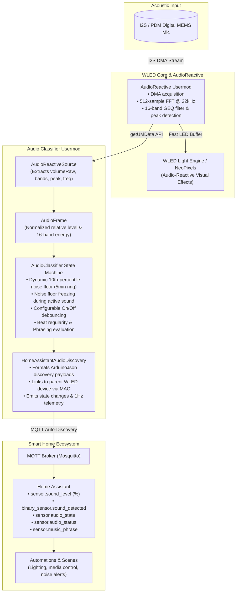

# WLED Audio Classifier Usermod

[](https://github.com/Steppschuh/wled-usermod-audio-classifier/actions/workflows/build-firmware.yml)
[](LICENSE)
[](https://github.com/Steppschuh/wled-usermod-audio-classifier/releases)

**Bring ambient acoustic intelligence into Home Assistant using your existing WLED hardware.**

This [WLED](https://github.com/wled/WLED) Usermod (V2) bridges the gap between WLED and Home Assistant. While WLED's native **AudioReactive** engine uses the microphone to animate your LED strips, this usermod taps into that same audio stream to classify room acoustics and automatically expose rich sensors to **Home Assistant via MQTT Auto-Discovery**—with zero manual YAML configuration and zero impact on your LED frame rates.

---

## 🎯 Purpose: Home Assistant Acoustic Presence

PIR motion sensors miss people sitting still, and mmWave radars cannot tell if a room is active with music, conversation, or media playback. Since commercial WLED controllers (like the **Gledopto GL-C-015WL-D / GL-C-010WL**) and DIY builds often live in central rooms with built-in microphones, this usermod turns them into dual-purpose devices:

1. **Keep your light shows**: Audio-reactive LED effects continue running in real time.
2. **Power your automations**: Home Assistant gains debounced acoustic presence, sound levels, and room state classification (`silence`, `ambient_noise`, `music`) to trigger lights, media players, and scenes.

---

## ✨ Features

- **Home Assistant Auto-Discovery**: Automatically discovers and attaches entities directly to your existing WLED device in Home Assistant over MQTT. Zero manual configuration.
- **AudioReactive Coexistence**: Reads internal in-memory FFT and volume telemetry (`getUMData`) without competing for I2S microphone hardware.
- **Freeze-Locked Noise Floor**: Computes room ambient baseline using a 10th-percentile filter over a 5-minute rolling window. Freezes automatically during active sound so continuous music playback never drifts into "ambient noise".
- **Debounced Presence Detection**: Configurable on-delay (1.2s) and off-delay (8.0s) suppress transient spikes (doors closing, claps) and prevent automations from flapping during song pauses.
- **100% Local & Privacy Preserving**: All classification runs entirely on-device in volatile RAM. No audio is ever recorded or transmitted.

---

## 📡 Home Assistant Entities

When MQTT is connected, the following entities appear automatically under your WLED device in Home Assistant:

| Entity Name | Domain | Type | Values / Unit | Description |
| :--- | :--- | :--- | :--- | :--- |
| **`Sound Level`** | `sensor` | Measurement | `0.0` – `100.0 %` | Relative sound volume percentage (updated at 1 Hz). |
| **`Sound Detected`** | `binary_sensor` | `sound` | `ON` / `OFF` | Debounced presence indicator for active sound in the room. |
| **`Audio State`** | `sensor` | `enum` | `silence`, `ambient_noise`, `music` | Contextual room acoustic state. |
| **`Audio Source Status`** | `sensor` | Diagnostic | Text | Live coupling health with AudioReactive and microphone stream. |
| **`Music Phrase`** | `sensor` | Diagnostic | `steady`, `buildup`, `breakdown`, `drop` | Musical phrasing state (when `experimental-music` is enabled). |

---

## 🛠️ Supported Hardware

| Hardware | Status | Microphone Type | Pin Configuration |
| :--- | :---: | :--- | :--- |
| **Gledopto GL-C-015WL-D** | 🟢 Tested | Built-in I2S MEMS | Handled by AudioReactive (`SD: 26`, `WS: 5`, `SCK: 21`) |
| **Gledopto GL-C-010WL** | 🟢 Supported | Built-in I2S MEMS | Handled by AudioReactive (`SD: 26`, `WS: 5`, `SCK: 21`) |
| **ESP32 + INMP441** | 🟢 Tested | Digital I2S Breakout | Configure in AudioReactive (e.g. `SD: 32`, `WS: 15`, `SCK: 14`). Connect L/R to GND, power with 3.3V only! |
| **ESP32 + SPH0645** | 🟢 Supported | Digital I2S Breakout | Select `SPH0645` in AudioReactive settings |
| **ESP32-S3 + I2S / PDM** | 🟢 Supported | Digital I2S / PDM | Fully supported via AudioReactive |

> **Note**: Audio hardware pins are managed entirely by `AudioReactive`. You do **not** configure GPIO pins in AudioClassifier.

---

## 🚀 Installation & Flashing

Pre-compiled binaries are available on the **[Releases](https://github.com/Steppschuh/wled-usermod-audio-classifier/releases)** page.

### Method 1: Web Browser OTA Update (Existing WLED Device)
1. Download the latest OTA binary (`*_ota.bin`, e.g. `wled_audio_classifier_esp32dev_ota.bin`) from [Releases](https://github.com/Steppschuh/wled-usermod-audio-classifier/releases).
2. Open your controller's web interface (`http://<wled-ip>`).
3. Navigate to **Config (⚙️) > Security & Updates**.
4. Under **Manual OTA Update**, click **Choose File**, select the `*_ota.bin` file, and click **Update!**.
5. The device reboots after ~30–45 seconds, preserving your existing WiFi credentials and LED settings.
6. Verify under **Config > Usermods** that both `AudioReactive` and `AudioClassifier` are enabled.
7. Ensure your MQTT broker is configured under **Config > Sync Interfaces > MQTT** so entities can publish to Home Assistant.

### Method 2: Browser USB Web Flasher (New or Unconfigured Device)
1. Connect your controller to your computer with a USB data cable.
2. Download the latest factory binary (`*_factory.bin`) from [Releases](https://github.com/Steppschuh/wled-usermod-audio-classifier/releases).
3. Open **[ESP Web Tools](https://web.esphome.io/)** or **[Adafruit ESPTool](https://adafruit.github.io/Adafruit_WebSerial_ESPTool/)** in Chrome or Edge.
4. Click **Connect**, select your serial port, and flash the `*_factory.bin` at address `0x0000`.
5. Connect to the setup Wi-Fi hotspot (`WLED-AP`, password: `wled1234`) to configure your network credentials.

### Method 3: Compile Locally with PlatformIO
Add the usermod to your `platformio_override.ini`:
```ini
[platformio]
default_envs = esp32dev

[env:esp32dev]
custom_usermods =
  ${common.default_usermods}
  https://github.com/Steppschuh/wled-usermod-audio-classifier.git
```
Then build and flash:
```bash
pio run -e esp32dev -t upload
```

---

## ⚙️ Configuration & Tuning

### 1. AudioReactive Settings
Open **Config > Usermods > AudioReactive** to configure the audio input stage:

| Setting | Recommended | Meaning & Impact |
| :--- | :--- | :--- |
| **`enabled`** | `Checked` | Required for audio acquisition. |
| **`AGC` (Gain Control)** | **`0 (Off)`** | **`0 (Off)`** provides true room dynamics (recommended for acoustic presence).<br>**`1 (Normal)`** or **`3 (Lazy)`**: Adapts gain over time for lighting effects while keeping sensing usable.<br>**`2 (Vivid)`**: Aggressively boosts quiet sounds, causing volume levels to float. |
| **`squelch`** | `4` – `10` | Baseline noise gate. Cuts out microphone electrical self-noise and inaudible hiss. |
| **`gain`** | `40` – `70` | Digital amplification multiplier. Scales signal so normal conversation hits ~20–35%. |

#### Diagnostic Statuses
The info modal (ℹ️) and Home Assistant report coupling health:
- `OK (Coupled with AudioReactive)`: Operational.
- `Warning: AudioReactive is disabled in settings`: Enable AudioReactive in Usermods settings.
- `Warning: AudioReactive AGC is enabled (relative levels will float)`: Relative levels adjust dynamically with AGC.
- `Info: AudioReactive is in network receive mode`: Audio telemetry is streamed from another WLED instance.
- `Warning: No audio signal detected from AudioReactive (>30s)`: Check microphone hardware wiring.
- `Error: AudioReactive usermod not present in build`: Ensure firmware includes AudioReactive.

### 2. AudioClassifier Usermod Settings
Configure under **Config > Usermods > AudioClassifier**:

| Setting | Type | Default | Unit | Description |
| :--- | :--- | :--- | :--- | :--- |
| **`enabled`** | bool | `true` | — | Master toggle for audio classification. |
| **`mqtt-auto-discovery`** | bool | `true` | — | Automatically publish Home Assistant MQTT discovery entities. |
| **`quiet-threshold`** | float | `6.0` | `%` | Absolute silence cutoff floor. |
| **`margin-above-floor`** | float | `4.0` | `%` | Trigger margin required above ambient noise floor. |
| **`on-delay`** | int | `1200` | `ms` | Continuous sound duration required before triggering presence. |
| **`off-delay`** | int | `8000` | `ms` | Continuous silence duration required before clearing presence. |
| **`music-hold`** | int | `20000` | `ms` | Hold time in music state during quiet bridges/breakdowns. |
| **`experimental-music`** | bool | `false` | — | Enable beat regularity and musical phrasing tracking (`steady`, `buildup`, `breakdown`, `drop`). |
| **`stream-raw`** | bool | `false` | — | Stream raw audio frames over MQTT (`wled/<device>/audio/raw`) for analysis. |

### 3. Step-by-Step Calibration Guide

Follow this 3-step procedure using WLED's live status readouts (in the **Info modal ℹ️** or Home Assistant `Sound Level`):

#### Step 1: Calibrate Squelch (Noise Gate)
1. Keep the room **completely quiet** (no speech, no media, only resting ambient background).
2. In **Config > Usermods > AudioReactive**, set **`AGC` to `0 (Off)`**, **`Gain` to `50`**, and **`Squelch` to `0`**. Save.
3. Observe `Sound Level (%)`. With squelch at `0`, microphone electrical self-noise will typically produce a jittery `2% – 8%` reading.
4. Increase **`Squelch` in steps of +2** (e.g. `2`, `4`, `6`, `8`...) and save until the silent room baseline drops to **`0.0% – 1.0%`**.
   * *Typical values*: `4`–`8` for I2S/PDM digital microphones, `8`–`15` for analog microphones.

#### Step 2: Calibrate Gain (Sensitivity)
1. Speak at your **normal conversational volume** from where you typically sit in the room (or play typical background music).
2. Check the live `Sound Level (%)`:
   * **Target**: Conversational speech should register around **`20% – 35%`**.
   * **Target**: Loud claps or hand gestures should peak around **`70% – 90%`** without constantly clipping at `100%`.
3. Adjust **`Gain`**:
   * If normal speech registers below `15%`: Increase Gain (e.g. `65`–`80`).
   * If normal speech easily pegs at `80% – 100%`: Decrease Gain (e.g. `35`–`45`).
   * *Typical values*: `40`–`70`.

#### Step 3: Set AudioClassifier Thresholds
1. With Squelch and Gain dialed in, observe the resting room baseline with normal background sounds (HVAC, fans) running (e.g. `2.5%`).
2. In **Config > Usermods > AudioClassifier**:
   * Set **`quiet-threshold`** to **~2% – 3% above** your quiet room baseline (e.g. `5.0%` for a `2.5%` baseline).
   * Leave **`margin-above-floor`** at `4.0%` (sound must rise 4% above the rolling ambient floor to trigger).
   * If brief transient noises (footfalls, closing doors) trigger presence, increase **`on-delay`** (`1500`–`2000 ms`).
   * If presence clears during quiet song bridges or pauses between tracks, increase **`off-delay`** (`10000`–`15000 ms`).

#### Quick Troubleshooting

| Symptom | Cause | Action |
| :--- | :--- | :--- |
| Baseline never drops to `0–1%` in dead silence | Squelch too low | **Increase Squelch** (+2) |
| Whispers or soft speaking aren't detected | Squelch too high | **Decrease Squelch** (-2) |
| Normal speech registers below `15%` | Gain too low | **Increase Gain** |
| Ambient background triggers high volume | Gain too high | **Decrease Gain** |
| Reported volume drifts or floats over time | AudioReactive AGC enabled | **Set AGC to `0 (Off)`** |

---

## 📬 MQTT Topic Structure

Topics derive from WLED's configured MQTT Device Topic (`wled/<mac>`):

| Subtopic | Format | Update Rate | Description |
| :--- | :--- | :--- | :--- |
| `<device>/audio/level` | Float (`24.5`) | 1 Hz + Heartbeat | Relative sound percentage |
| `<device>/audio/sound` | `ON` / `OFF` | On change + Heartbeat | Debounced sound presence |
| `<device>/audio/state` | String (`silence`, `ambient_noise`, `music`) | On change + Heartbeat | Semantic acoustic state |
| `<device>/audio/status` | String (diagnostic message) | On change + Heartbeat | AudioReactive coupling state |
| `<device>/audio/phrase` | String (`steady`, `buildup`, `breakdown`, `drop`) | On change + Heartbeat | Phrasing state (if enabled) |

- **Availability**: Tracked automatically via `<device>/status` (`online` / `offline`).
- **Clean Unenrollment**: Turning off `mqtt-auto-discovery` publishes empty retained messages to automatically remove entities from Home Assistant.

---

## 🧩 Architecture & Technical Design



### Noise Floor Estimation & Stability
Simple moving-average baselines suffer from **baseline creep**: continuous music or conversation gradually inflates the baseline, causing the system to classify ongoing sound as ambient room silence.

AudioClassifier solves this using two mechanisms:
1. **10th-Percentile Sliding Window**: Sound levels are binned into a 101-bucket histogram over a 300-second (5-minute) circular buffer. The true room noise floor is extracted at the 10th percentile.
2. **Noise Floor Freezing**: Whenever sound presence is detected (`SOUND` state), histogram ingestion is frozen. The baseline remains locked to the true room baseline even during hours of continuous music. Once sound stops and the `off-delay` timer elapses, normal background tracking resumes.

---

## 📄 License

Licensed under the **European Union Public Licence v1.2** ([EUPL-1.2](LICENSE)).

*Disclaimer: This project is an independent community open-source usermod and is not affiliated with or endorsed by Gledopto or the core WLED project.*
