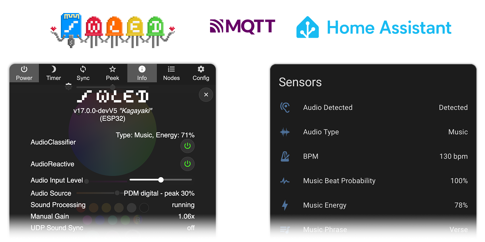

# WLED Audio Classifier Usermod

[](https://github.com/Steppschuh/wled-usermod-audio-classifier/releases/latest)
[](LICENSE)

A [WLED](https://github.com/wled/WLED) usermod (v2) that turns your ESP32-based controller into an on-device audio classifier and music analyzer.

It reads WLED's `AudioReactive` FFT and volume stream directly in memory to detect sound presence, classify audio type (`Silence`, `Ambient Noise`, `Music`), estimate BPM, and track song energy and structure. Everything runs locally on the controller and can be used in two ways (or both at once):

- **[Standalone preset switching](#standalone-auto-reactive-preset-switching)**: Automatically switch WLED presets based on music energy and song structure, with no external server required.
- **[Home Assistant integration](#home-assistant-integration)**: Expose audio classification sensors via MQTT auto-discovery for custom automations and multi-device setups.

Works with off-the-shelf controllers (e.g. Gledopto GL-C-015WL-M, GL-C-310WL) and DIY ESP32 builds.

> 📖 **New to WLED or setting up a controller for the first time?**
> Follow the step-by-step **[Getting Started Guide in the Wiki](https://github.com/Steppschuh/wled-usermod-audio-classifier/wiki/Getting-Started)**.

---

## Features

- **Music Energy, Phrasing & BPM**: Tracks continuous musical energy (`0–100%`), song sections (`Intro`, `Verse`, `Buildup`, `Chorus`, `Breakdown`, `Outro`), and tempo (`60–240 bpm`) with octave-jump rejection and breakdown hold.
- **Debounced Sound Presence & Audio Type**: Separates `Silence`, `Ambient Noise`, and `Music` with configurable on/off delays so claps, door slams, and brief pauses don't cause false triggers.
- **Adaptive Noise Floor**: Learns the room's ambient baseline using a 5-minute 10th-percentile filter and freezes updates during active sound to avoid baseline creep.
- **Local, Private & Low Overhead**: Reads FFT and volume data in memory (`getUMData`) without competing for the I2S bus. Raw microphone audio is never recorded, stored, or sent over the network.

---

## Standalone Auto-Reactive Preset Switching

If you don't run Home Assistant or an MQTT broker, the usermod can switch presets on its own:

1. **Assign presets to energy slots** in **Config > Usermods > AudioClassifier > Automation**:
   - Enter a specific preset ID (`1–250`) for any slot directly, or leave it at `0` (default) to match presets by name prefix:
     - `Ambient *` (e.g. `Ambient Warm Glow`): Used during `Silence` or non-musical `Ambient Noise`.
     - `AR Low *` (e.g. `AR Low Chill Breath`): Used during quiet song `Intro`, `Breakdown`, and `Outro` sections.
     - `AR Mid *` (e.g. `AR Mid Smooth Waves`): Used during steady `Verse` sections.
     - `AR High *` (e.g. `AR High Fast Chase`): Used during rising `Buildup` sections.
     - `AR Max *` (e.g. `AR Max Strobe Impact`): Used during peak `Chorus` and drop sections.
2. **Enable Auto Switch Presets** under **Config > Usermods > AudioClassifier** (or via the Home Assistant switch entity or `/json/state` API).
3. As the audio changes, the controller picks matching presets, rotates through prefix-matched pools without immediate repeats, falls back to adjacent `AR *` pools if a slot has no match, enforces a configurable cooldown (default 15 s), and pauses if you change the lighting manually.

👉 **See the [Standalone Preset Switching Wiki Guide](https://github.com/Steppschuh/wled-usermod-audio-classifier/wiki/Standalone-Preset-Switching)** for a beginner walkthrough on creating presets, starter effect recommendations, and troubleshooting.

---

## Home Assistant Integration

When MQTT is enabled in WLED (**Config > Sync Interfaces > MQTT**), the classifier automatically discovers the following entities under your WLED device in Home Assistant:

| Entity | Type | Values / Range | Description |
| :--- | :--- | :--- | :--- |
| **`Audio Detected`** | Binary Sensor (`sound`) | `On` / `Off` | Debounced sound presence (default 1.2 s on-delay, 8.0 s off-delay). |
| **`Audio Type`** | Sensor | `Silence`, `Ambient Noise`, `Music` | Current room acoustic classification. |
| **`Music Phrase`** | Sensor | `Intro`, `Verse`, `Buildup`, `Chorus`, `Breakdown`, `Outro`, `Unknown` | Current structural section of the playing track. |
| **`Music Energy`** | Sensor | `0%` – `100%` | Dynamic musical intensity (`0%` when `Audio Type` is not `Music`). |
| **`BPM`** | Sensor | `60` – `240 bpm` (`0` when inactive) | Detected music tempo with octave-jump rejection and breakdown hold. |
| **`Music Beat Probability`** | Sensor | `0.0%` – `100.0%` | Low-frequency beat regularity confidence score. |
| **`Audio Classifier`** | Switch | `On` / `Off` | Master toggle for on-device audio classification. |
| **`Auto Switch Presets`** | Switch | `On` / `Off` | Toggles standalone preset switching from Home Assistant. |
| **`Audio Level RMS`** | Diagnostic Sensor | `0.0%` – `100.0%` | 1-second rolling average sound level. |
| **`Audio Level Peak`** | Diagnostic Sensor | `0.0%` – `100.0%` | Peak volume spike over the last 1-second window. |
| **`Audio Source Status`** | Diagnostic Sensor | `OK`, `Clipping, reduce gain`, `AudioReactive mod disabled/missing` | Microphone input health and clipping indicator. |

### Example Automations

When connected to Home Assistant, these entities let you go beyond standalone preset switching in two ways:

#### Controlling WLED and AudioClassifier from Home Assistant
- **Sync colors with other room lights**: Let standalone mode pick the audio-reactive effect and energy slot while an automation copies the current RGB color or palette from other smart lights, a TV backlight, or your circadian lighting scene.
- **Pause auto-switching by context**: Toggle `Auto Switch Presets` off when a movie starts, a work call is active, or quiet hours begin, and turn it back on when the room is free again.
- **Sensor-driven fine tuning**: Combine `BPM` or `Music Energy` with external sensors (like a room lux sensor or sun elevation) to scale WLED brightness and effect speed more granularly than static presets.

#### Controlling Other Devices with Audio Data
- **Motion + audio occupancy**: Combine `Audio Detected` with a PIR motion sensor so lights stay on while people are talking or watching TV without moving.
- **Unexpected sound alerts**: Send a notification or blink an indicator light when `Audio Detected` or `Audio Level Peak` spikes while the house is in away or night mode.
- **Coordinate other room lights**: Use `Audio Type` or `Music Phrase` (for example, `Chorus` vs. `Breakdown`) to dim overhead smart bulbs or toggle accent lamps to match the mood of the room.

👉 **See the [Home Assistant Integration Wiki Guide](https://github.com/Steppschuh/wled-usermod-audio-classifier/wiki/Home-Assistant-Integration)** for MQTT broker setup, precision microphone calibration, and copy-pasteable automation YAML.

---

## Installation

Pre-compiled binaries are published on the [**Releases**](https://github.com/Steppschuh/wled-usermod-audio-classifier/releases) page:

- **Existing WLED Controller (OTA Update)**: Download `WLED_*_ESP32.bin` and upload it in your controller's web UI under **Config > Security & Updates > Manual OTA Update**.
- **Blank ESP32 Board (USB Flash)**: Download `WLED_*_ESP32_factory.bin` and flash it over USB at offset `0x0000` using [ESPHome Web Flasher](https://web.esphome.io/).
- **Build from Source (PlatformIO)**: Add `https://github.com/Steppschuh/wled-usermod-audio-classifier.git` alongside `audioreactive` under `custom_usermods` in `platformio_override.ini` and run `pio run -e esp32dev -t upload`.

👉 **Need detailed setup instructions?** Follow the **[Getting Started Wiki Guide](https://github.com/Steppschuh/wled-usermod-audio-classifier/wiki/Getting-Started)** for first-time Wi-Fi setup, microphone pin configuration, `AudioReactive` / `AudioClassifier` settings reference, and Gain/Squelch calibration.

---

## Testing & Development

The core classifier (`src/classifier.{h,cpp}`) and preset controller (`src/auto_preset_controller.{h,cpp}`) have zero hardware or WLED dependencies and run natively on macOS/Linux:

```bash
pio test -e native
```

### Capturing & Replaying Session Fixtures
```bash
# Record live audio frames over MQTT into a JSON test fixture:
python3 tools/record_session.py --broker <mqtt-ip> --wled-ip <wled-ip> --duration 60 --label music

# Replay and plot telemetry offline:
python3 tools/replay_session.py test/fixtures/session_*.json --plot
```

See [AGENTS.md](AGENTS.md) and [CONTRIBUTING.md](CONTRIBUTING.md) for architecture details and contribution guidelines.

---

## License

Licensed under the [European Union Public Licence v1.2](LICENSE) (EUPL-1.2).

*This project is an independent community usermod and is not affiliated with or endorsed by the WLED project, Home Assistant, or MQTT.*
