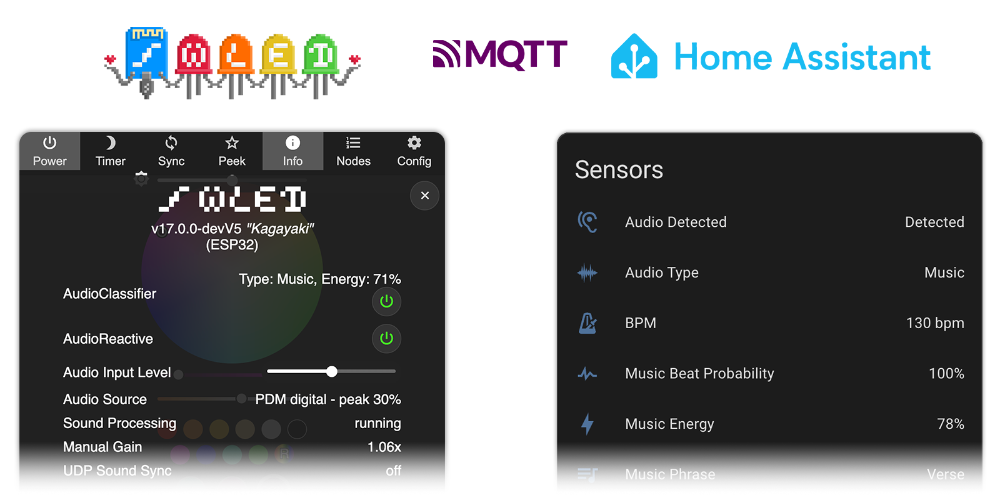

# WLED Audio Classifier Usermod

[](https://github.com/Steppschuh/wled-usermod-audio-classifier/releases)
[](https://github.com/Steppschuh/wled-usermod-audio-classifier/actions/workflows/build-firmware.yml)
[](LICENSE)

A [WLED](https://github.com/wled/WLED) usermod (v2) that turns your controller's microphone into an acoustic presence and music sensor for Home Assistant over MQTT.

It taps into WLED's built-in `AudioReactive` stream in memory—with zero impact on LED frame rates—to classify room audio, track tempo (BPM), and detect song structure. Works with off-the-shelf microphone controllers (e.g. Gledopto GL-C-015WL-M, GL-C-310WL) and DIY ESP32 builds.

---

## Features

- **MQTT Auto-Discovery**: Attaches all sensors and controls directly to your WLED device in Home Assistant without manual YAML.
- **Zero-Overhead AudioReactive Coupling**: Reads FFT and volume data in memory (`getUMData`) without competing for I2S bus access.
- **Adaptive Noise Floor**: Tracks ambient room baseline via a 5-minute 10th-percentile filter, freezing during active sound to prevent baseline creep.
- **Debounced Sound Presence**: Configurable on/off delays (1.2 s / 8.0 s) ignore transient noises (claps, door slams) and brief track pauses.
- **Musical Phrase & Energy Tracking**: Identifies `Intro`, `Verse`, `Buildup`, `Chorus`, `Breakdown`, and `Outro` alongside a dynamic `0–100%` energy score.
- **BPM & Beat Confidence**: Estimates tempo (`60–240 bpm`) with octave-jump rejection and holds lock across quiet breakdowns.
- **Auto Switch Presets**: Autonomously switches WLED presets by energy and musical phrase using preset name prefixes (`Ambient`, `AR Low`, `AR Mid`, `AR High`, `AR Max`) or explicit preset IDs—no Home Assistant required.
- **100% Local & Private**: Processes FFT data in volatile ESP32 RAM; no audio is ever recorded or streamed.

---

## Home Assistant Entities

When MQTT is enabled, these entities are added to your WLED device in Home Assistant:

### Audio Detected
Binary sensor (`sound` device class) that turns `on` during sustained sound and `off` when the room is quiet. Default delays require 1.2 s of continuous sound to trigger and 8.0 s of silence to clear, filtering out short noises like door slams.

### Audio Type
Contextual sensor that classifies the room into one of three states:
- `Silence`: Sound level is at or below the ambient room baseline.
- `Ambient Noise`: Sustained non-musical sound such as conversation, TV dialogue, fans, or kitchen activity.
- `Music`: Rhythmic and harmonic sound with structural musical properties.

### Music Phrase
Song structure classification based on tension-and-release electronic music arrangement:
- `Intro`: Initial beat or melodic introduction.
- `Verse`: Steady melodic groove or vocal section.
- `Buildup`: Rising snare roll, pitch riser, or volume crescendo before a drop.
- `Chorus`: Main drop or high-energy section.
- `Breakdown`: Quieter section where drums drop out; holds for at least 20 seconds before decaying.
- `Outro`: Ending section of a track.
- `Unknown`: Default state during silence, ambient noise, or before enough frames are collected.

### Music Energy
Dynamic energy metric (`0%` to `100%`) mapped to distinct, non-overlapping windows that breathe with live volume and song tension:
- `0%`: Silence or non-musical audio.
- `15% – 25%`: Breakdown (quiet breather, modulated by ambient pad and vocal presence).
- `30% – 40%`: Outro (mix-out section modulated by remaining percussion level).
- `45% – 55%`: Intro (incoming beat and initial melodic theme).
- `65% – 78%`: Verse (main steady groove modulated by vocal and bass punch).
- `80% – 95%`: Buildup (crescendo ramp escalating with riser volume and elapsed phrase duration).
- `95% – 100%`: Chorus / drop (high-impact climax hitting 100% on bass drops).

### Music Beat Probability
Confidence score from `0.0%` to `100.0%` indicating rhythm regularity based on low-frequency variance analysis (0% represents non-rhythmic noise or silence; 100% indicates a steady bass beat).

### BPM
Detected musical tempo from `60` to `240 bpm` (`0` when music is not active). Rejects octave doubling and syncopated eighth notes, and holds steady through quiet breakdowns.

### Audio Level RMS
Diagnostic sensor reporting the continuous 1-second rolling RMS sound level from `0.0%` to `100.0%`. Updates every second for dashboard gauges and automation conditions.

### Audio Level Peak
Diagnostic sensor reporting the peak volume recorded over the last 1-second window (`0.0%` to `100.0%`). Tracks instantaneous transients, percussion hits, and loud impacts.

### Audio Source Status
Diagnostic sensor reporting coupling health with WLED's AudioReactive engine (`OK`, `Clipping, reduce gain`, `AudioReactive mod disabled`, or `AudioReactive mod missing`).

### Auto Switch Presets
Switch entity (`switch.<device>_auto_switch_presets`) to toggle autonomous preset switching on or off directly from Home Assistant.

---

## Example Automations

- **Automatic audio-reactive lighting**: Switch from warm static lighting to an audio-reactive preset when music starts playing, and return to ambient lighting when it stops.
- **Song-aware lighting effects**: Increase brightness and switch to vivid color palettes during the chorus or drop, speed up animations during buildups, and dim to a slow pulse during breakdowns.
- **Tempo-matched animation speed**: Sync WLED effect speed to detected BPM so light pulses and color sweeps match the music tempo.
- **Occupancy fallback**: Combine motion sensors with `Audio Detected` to keep lights on while people are talking, reading, or watching TV without moving.
- **Late-night disturbance detection**: Flash a nightlight or send a notification if loud sounds occur during quiet hours.

---

## Installation & Flashing

Pre-compiled binaries are available on the [Releases](https://github.com/Steppschuh/wled-usermod-audio-classifier/releases) page.

### Method 1: OTA Update from WLED Web UI (Existing Device)
1. Download the release binary from [Releases](https://github.com/Steppschuh/wled-usermod-audio-classifier/releases).
2. Open your controller's web interface (`http://<wled-ip>`).
3. Navigate to **Config > Security & Updates**.
4. Under **Manual OTA Update**, click **Choose File**, select the `.bin` file, and click **Update!**.
5. Wait ~30–45 seconds for the controller to reboot. Existing Wi-Fi and LED settings are preserved.
6. Check **Config > Usermods** to confirm that both `AudioReactive` and `AudioClassifier` are enabled.

### Method 2: USB Web Flasher (New or Unconfigured Device)
1. Connect the controller to your computer with a USB data cable.
2. Download the factory binary (`*_factory.bin`, e.g. `WLED_16.0.1_MOD_0.2.0_ESP32_factory.bin`) from [Releases](https://github.com/Steppschuh/wled-usermod-audio-classifier/releases).
3. Open [ESP Web Tools](https://web.esphome.io/) or [Adafruit ESPTool](https://adafruit.github.io/Adafruit_WebSerial_ESPTool/) in Chrome or Edge.
4. Click **Connect**, select your serial port, and flash the `*_factory.bin` at offset `0x0000`.
5. Connect to the setup Wi-Fi hotspot (`WLED-AP`, password: `wled1234`) to configure your network credentials.

### Method 3: Build with PlatformIO
Add the usermod to your `platformio_override.ini`:
```ini
[platformio]
default_envs = esp32dev

[common]
default_usermods = audioreactive

[env:esp32dev]
custom_usermods =
  ${common.default_usermods}
  https://github.com/Steppschuh/wled-usermod-audio-classifier.git
```
Then compile and upload:
```bash
pio run -e esp32dev -t upload
```

### MQTT Setup
To receive auto-discovered entities, WLED and Home Assistant must connect to the same MQTT broker:

1. **Configure MQTT in Home Assistant**:
   - Ensure the [Home Assistant MQTT integration](https://www.home-assistant.io/integrations/mqtt/#broker-configuration) is set up under **Settings > Devices & Services > Add Integration > MQTT**.
   - If you do not have an MQTT broker running, install the official **Mosquitto broker** add-on via **Settings > Add-ons > Add-on Store**.
   - Make sure **Enable discovery** is turned on in the MQTT integration options (enabled by default).
2. **Configure MQTT in WLED**:
   - In the WLED web UI, go to **Config > Sync Interfaces > MQTT**.
   - Check **Enable MQTT**.
   - Enter your broker IP or hostname, port (`1883`), username, and password.
   - Leave the default topic (`wled/%mac%`) or enter a custom one.
   - Click **Save**.

---

## Configuration & Tuning

### 1. AudioClassifier Settings
Configure under **Config > Usermods > AudioClassifier**:

| Setting | Default | Description |
| :--- | :--- | :--- |
| **`Enabled`** | `true` | Master toggle for audio classification. |
| **`MQTT Auto-Discovery`** | `true` | Automatically publish Home Assistant MQTT discovery entities. |
| **`Quiet Threshold`** | `6.0 %` | Absolute silence cutoff floor. |
| **`Margin Above Floor`** | `4.0 %` | Margin required above ambient noise floor to trigger sound. |
| **`On Delay`** | `1200 ms` | Continuous sound duration required before triggering presence. |
| **`Off Delay`** | `8000 ms` | Continuous silence duration required before clearing presence. |
| **`Music Hold`** | `30000 ms` | Hold time in music state during quiet bridges and breakdowns. |
| **`Stream Raw`** | `false` | Stream raw audio frames over MQTT (`wled/<device>/audio/raw`) for analysis. |

#### Standalone Automation (`automation`)
Autonomously selects presets from `/presets.json` without an external automation server:

| Setting | Default | Description |
| :--- | :--- | :--- |
| **`Auto Switch Presets`** | `false` | Enable standalone preset switching. Can also be toggled via MQTT (`Auto Switch Presets`) or `/json/state` (`AudioClassifier.auto_switch_presets`). |
| **`Manual Override Hold`** | `true` | Pause automatic preset switching after manual WLED changes until audio returns to `Silence`. |
| **`Preset Cooldown`** | `15 s` | Minimum dwell duration enforced between automated preset changes. |
| **`Preset No Music`** | `0` | Preset ID (`1–250`) for `Silence` / `Ambient Noise`, or `0` to auto-discover presets starting with `Ambient` (`"Ambient *"`). |
| **`Preset Low Energy`** | `0` | Preset ID for `Breakdown`, `Intro`, and `Outro`, or `0` to auto-discover `"AR Low *"` presets. |
| **`Preset Mid Energy`** | `0` | Preset ID for `Verse`, or `0` to auto-discover `"AR Mid *"` presets. |
| **`Preset High Energy`** | `0` | Preset ID for `Buildup`, or `0` to auto-discover `"AR High *"` presets. |
| **`Preset Max Energy`** | `0` | Preset ID for `Chorus`, or `0` to auto-discover `"AR Max *"` presets. |

Prefix auto-discovery matches case-insensitively with any separator (e.g., `AR High: Strobe`, `AR High Strobe`, `AR High - Strobe`). When multiple presets match a slot, one is chosen randomly without immediate repeats; empty `AR *` pools fall back to the nearest populated AR energy pool.

### 2. AudioReactive Settings
Under **Config > Usermods > AudioReactive**, set up the input stage:

| Setting | Recommended | Meaning & Impact |
| :--- | :--- | :--- |
| **`enabled`** | `Checked` | Required for audio input. |
| **`AGC` (Gain Control)** | **`0 (Off)`** | **`0 (Off)`** preserves true room dynamics (recommended for presence).<br>**`1 (Normal)`** or **`3 (Lazy)`**: Adjusts gain gradually for lights while keeping sensing usable.<br>**`2 (Vivid)`**: Aggressively boosts quiet sounds, making volume levels float. |
| **`squelch`** | `4` – `10` | Noise gate. Cuts out microphone electrical noise and background hiss. |
| **`gain`** | `40` – `70` | Digital amplification. Scale so normal conversation registers around 20–35%. |

### 3. Calibration Walkthrough
Monitor the Home Assistant `Audio Level RMS` and `Audio Level Peak` diagnostic sensors while tuning:

1. **Squelch (Noise Gate)**: In a quiet room with `AGC` set to `0 (Off)` and `Gain` at `50`, increase **`Squelch`** in steps of `+2` until `Audio Level RMS` drops to **`0.0% – 1.0%`** (typically `4–8` for digital I2S/PDM mics, `8–15` for analog mics).
2. **Gain (Sensitivity)**: Speak at normal conversational volume from typical seating distance and adjust **`Gain`** so `Audio Level RMS` reads **`20% – 35%`** and loud claps peak around **`70% – 90%`** without clipping at `100%` (typically `40–70`).
3. **Classifier Thresholds**: Set **`Quiet Threshold`** ~2–3% above your resting background level (e.g. `5.0%` for a `2.5%` HVAC baseline). Increase **`On Delay`** (`1500–2000 ms`) if transient noises trigger presence, or increase **`Off Delay`** (`10000–15000 ms`) if presence clears during pauses.

#### Quick Troubleshooting

| Symptom | Cause | Action |
| :--- | :--- | :--- |
| Baseline never drops to `0–1%` in a quiet room | Squelch too low | Increase squelch (+2) |
| Soft speech is not detected | Squelch too high | Decrease squelch (-2) |
| Normal speech stays below `15%` | Gain too low | Increase gain |
| Ambient background noise reads as high volume | Gain too high | Decrease gain |
| Volume drifts or floats over time | AudioReactive AGC is on | Set AGC to `0 (Off)` |

---

## Testing & Development

The core classifier logic (`src/classifier.{h,cpp}`) has no hardware or WLED dependencies and compiles cleanly for native host testing:

```bash
pio test -e native
```

### Capturing Session Fixtures
To record acoustic telemetry from a running controller for regression testing:
```bash
# Record frames over MQTT into a synchronized JSON test fixture:
python3 tools/record_session.py --broker <mqtt-ip> --wled-ip <wled-ip> --duration 60 --label music

# Replay and plot telemetry offline:
python3 tools/replay_session.py test/fixtures/session_*.json --plot
```

Fixtures are replayed directly in the native Unity test suite with `FixtureReplayer`. See [AGENTS.md](AGENTS.md) and [CONTRIBUTING.md](CONTRIBUTING.md) for details.

---

## License

Licensed under the [European Union Public Licence v1.2](LICENSE) (EUPL-1.2).

*This project is an independent community usermod and is not affiliated with or endorsed by the WLED project, Home Assistant, or MQTT.*
