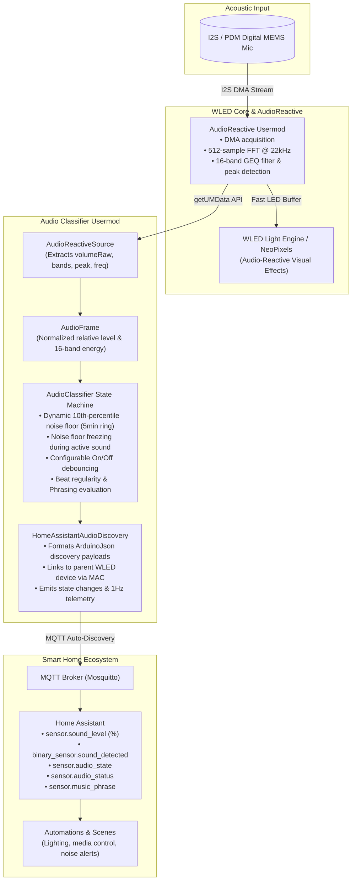

# Architecture & Technical Design Notes

---

## 🧩 System Architecture

`wled-usermod-audio-classifier` processes ambient acoustic telemetry in a decoupled, layered pipeline:

---

## 📊 Noise Floor Estimation & Stability

A major design flaw in naive sound sensors is **baseline creep**: when music or speech plays continuously for 15–30 minutes, an exponential moving average baseline slowly elevates to match the music volume, eventually classifying loud music as "ambient noise".

### 10th-Percentile Sliding Window
To prevent baseline creep:
1. Every 1000 ms, the 1-second energy average level is calculated.
2. If `presence == QUIET`, the sample is inserted into a 101-bin histogram across a 300-second (5-minute) circular buffer.
3. The 10th percentile is evaluated directly from the histogram.
4. **Noise Floor Freezing**: When active sound presence is detected (`presence == SOUND`), histogram updates are frozen. Even if a party plays loud music for 4 hours, the noise floor remains locked to the true ambient room baseline. When music stops, normal ambient tracking resumes after the `offDelayMs` debounce expires.

